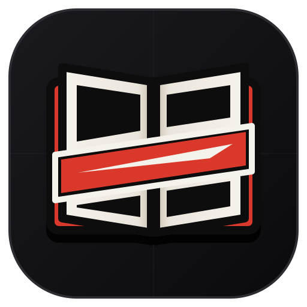

# MIHIRAKI (見開き)

<div align="center">



### *The Flagship Neo-Brutalist Manga Reader*

**100% Canvas Presence • Aspect-Ratio Spread Intelligence • E-Ink Screentone Filters • Zero-Cloud OPFS Persistence**

[](#)
[](#)
[](#)
[](#)
[](#)
[](#)

</div>

---

```
   __  __ _____ _    _ _____ _____            _  _______ 
  |  \/  |_   _| |  | |_   _|  __ \     /\   | |/ /_   _|
  | \  / | | | | |__| | | | | |__) |   /  \  | ' /  | |  
  | |\/| | | | |  __  | | | |  _  /   / /\ \ |  <   | |  
  | |  | |_| |_| |  | |_| |_| | \ \  / ____ \| . \ _| |_ 
  |_|  |_|_____|_|  |_|_____|_|  \_\/_/    \_\_|\_\_____|
```

> **Mihiraki (見開き)** is a Japanese publishing term referring to a **two-page spread opening**. This reader is engineered specifically for manga purists who want an uncompromising, distraction-free reading experience with zero visible UI chrome, intelligent page pairing, and hardware-accelerated local performance.

---

## ⚡ Key Highlights

### 📖 Aspect-Ratio Aware Double-Page Engine
- **Zero-Seam Double-Page Spreads:** Pairs vertical portrait pages flush against each other with a 0px seam and inner spine shadow.
- **Smart Landscape Isolation:** Automatically inspects page dimensions—double-wide panorama battle spreads (`aspect ratio > 1.15`) stand alone full-width without breaking subsequent page pairing.
- **Manga Cover Offset (OFF by Default):** Page 1 and Page 2 pair immediately in RTL order (Page 1 on right, Page 2 on left), matching tankōbon releases.
- **RTL & LTR Flow:** Native Japanese Right-to-Left panel reading order with instant one-touch LTR switching for Western comics.

### 🖤 Stealth Top-Right HUD (100% Pure Canvas)
- **Zero On-Screen Clutter:** No header banners, no floating pill overlays, and zero scrollbar clutter while reading.
- **Micro Trigger Zone:** A minimal 6px crimson dot in the top-right corner that reveals a compact, tactile neo-brutalist popover card when hovered or clicked.
- **Interactive Scrubber:** Jump directly to any page, track read percentage, and toggle reading modes in one click.
- **Auto-Collapse:** Disappears automatically on scroll, click-away, or `Esc`.

### ⚡ E-Ink & Screentone Shader Filter
A single-key (`E`) monochrome grading engine designed to enhance ink lines, sharpen fine screentones, eliminate digital scanning moiré, and reduce eye fatigue:
| Mode | Shading Filter | Purpose |
| :--- | :--- | :--- |
| **OFF** | Standard | Original color / raw scan rendering |
| **B&W INK** | `grayscale(100%) contrast(165%) brightness(95%)` | Deep inky blacks, bright whites, high-contrast line art |
| **WARM SEPIA** | `sepia(45%) contrast(108%) brightness(96%) hue-rotate(-15deg)` | Vintage tankōbon paper tone, low eye strain for night reading |
| **OLED NIGHT** | `invert(100%) hue-rotate(180%) contrast(125%)` | Pure `#000000` dark canvas for zero glare on OLED screens |

### 💾 OPFS (Origin Private File System) Zero-Cloud Storage
- **100% Local & Sandboxed:** Direct browser filesystem access via `navigator.storage.getDirectory()`.
- **Instant 1GB+ Volume Reopening:** Opened `.cbz`, `.zip`, and `.pdf` files are stored in the local sandbox. Clicking any volume in **RECENT VOLUMES** reloads it at local bus speed without prompting to re-select or re-upload files.
- **Full Offline Reading:** Zero server dependencies—read your entire offline library on airplanes, trains, or off-grid.

### 🧠 Settings & Page-Left Memory
- **Remembers Settings:** Your chosen E-Ink filter, view mode, spread mode, zoom level, and reading direction persist across browser sessions.
- **Resumes Where You Left Off:** Tracks your active spread and automatically scrolls back to the exact page left when reopening any book.

---

## 🎮 Keyboard Controls

| Key | Action |
| :---: | :--- |
| <kbd>E</kbd> | Cycle E-Ink Shading Filter (`Off` → `B&W Ink` → `Warm Sepia` → `OLED Night`) |
| <kbd>←</kbd> / <kbd>→</kbd> | Next / Previous Spread (respects RTL / LTR direction) |
| <kbd>Space</kbd> / <kbd>↓</kbd> | Smooth Scroll Down (Continuous Scroll) or Next Spread (Paginated) |
| <kbd>↑</kbd> | Smooth Scroll Up |
| <kbd>D</kbd> | Toggle Spread Mode (`2-PAGE` ⇄ `1-PAGE`) |
| <kbd>M</kbd> | Toggle Reading Direction (`RTL` ⇄ `LTR`) |
| <kbd>C</kbd> | Toggle Cover Page Offset (`COVER OFF` ⇄ `COVER 1P`) |
| <kbd>V</kbd> | Toggle View Mode (`SCROLL` ⇄ `FLIP`) |
| <kbd>+</kbd> / <kbd>-</kbd> | Zoom In / Zoom Out |
| <kbd>0</kbd> | Reset Zoom (`100%`) |
| <kbd>F</kbd> | Toggle Fullscreen |

---

## 📂 Supported Formats

| Format | Engine | Features |
| :---: | :---: | :--- |
| **`.cbz` / `.zip`** | `fflate` in-memory decompressor | Natural alphabetical sort (`Ch_01`, `Ch_02`, `Ch_10`), fast image dimension detection |
| **`.pdf`** | `pdfjs-dist` + canvas rasterizer | High-DPI canvas rendering, CMap support, aspect-ratio inspection |
| **Google Drive** | Direct stream proxy | Streams public/shared Drive files directly into the reader and caches to OPFS |

---

## 🎨 Neo-Brutalist Design Tokens

| Token | Hex | Role |
| :--- | :--- | :--- |
| `--bg-void` | `#0b0b0d` | Deep space backdrop & technical blueprint grid |
| `--bg-obsidian`| `#1a1a1e` | Structural cards, stealth HUD popover, controls |
| `--border-steel`| `#2c2c32` | 2px neo-brutalist structural borders |
| `--ink-black` | `#08080a` | Hard offset drop-shadows (`0 10px 0 #08080a`) |
| `--paper-cream`| `#f5f2eb` | Primary typography and active icons |
| `--crimson` | `#d93829` | Mihiraki katana slash accent, active toggles, scrubber thumb |

---

## 🚀 Getting Started

### Prerequisites
- Node.js (v18 or later)
- npm or bun

### Installation
```bash
# Clone the repository
git clone https://github.com/your-username/mihiraki.git
cd mihiraki

# Install dependencies
npm install

# Start development server
npm run dev
```

Visit `http://localhost:3000` in your browser.

### Building for Production
```bash
# Build the production bundle
npm run build

# Preview production build
npm run preview
```

### Running Unit Tests
```bash
npx --yes tsx --test src/utils/spreadEngine.test.ts
```

---

## 📄 License

Licensed under the [Apache License, Version 2.0](./LICENSE).
